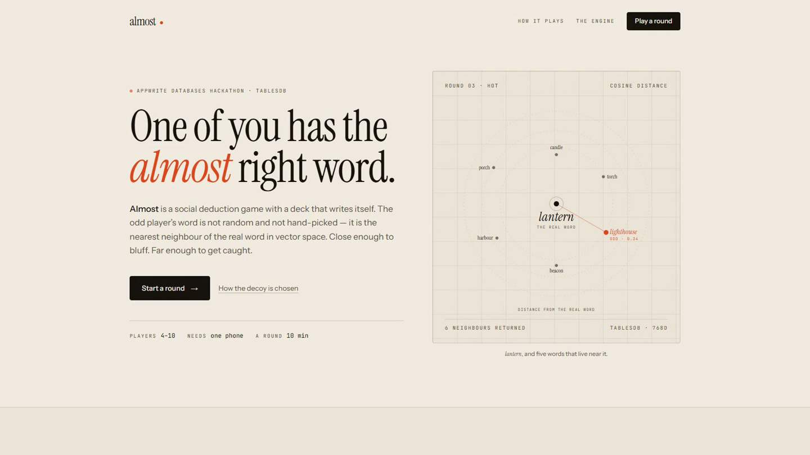
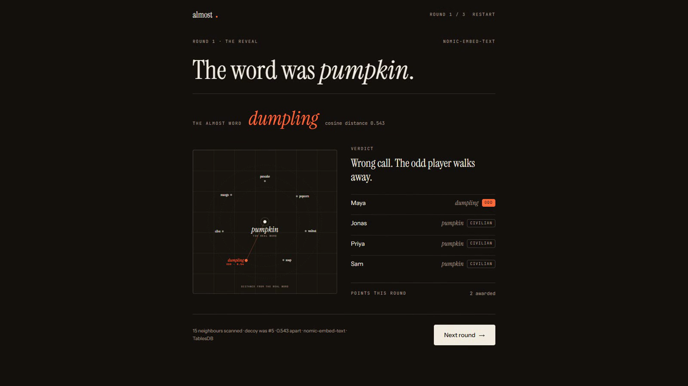

# Almost

**The party game of near-miss words.** Everyone gets the same secret word — except one player, who
gets its nearest neighbour in meaning. Describe, accuse, and watch the reveal show exactly how close
the two words were.

[](https://youtu.be/VRZLE-Bt61s)

▶ **[Watch the 2-minute demo](https://youtu.be/VRZLE-Bt61s)**

Built solo for the [Appwrite Databases Hackathon](https://hackathon.appwrite.io), October 2026.
Runs on **Appwrite TablesDB** — no vector service, no external AI key.




## The idea

Word games ship with hand-written decks: `cat / dog`, `beach / desert`. The deck is finite, uneven,
and the difficulty is whatever the author guessed.

Almost has no deck. Every word is stored once with its embedding, and a round is built from the
word's neighbourhood in meaning. The odd player's word is not random and not authored — it is the
**nearest neighbour** of the real word, close enough to bluff and far enough to lose.

## How a round is built

Each word is stored in TablesDB with a 768-dimension embedding and its **40 nearest neighbours**
(cosine distance), computed once at build time with Appwrite's `nomic-embed-text` model.

1. Pick a random row from `words`, filtered by deck.
2. Read that row's precomputed neighbour list.
3. Draw a decoy from the top of the list — how deep depends on the spice level.
4. Deal one word to the odd player, the secret to everyone else.

The distance is the difficulty dial and the reveal: players see the exact cosine distance that
decided the round.

### Data model

| Table | Columns | Used for |
|---|---|---|
| `words` | `word`, `deck`, `embedding`, `neighbours` | The meaning graph |
| `rounds` | `gameId`, `roundIndex`, `deck`, `spice`, `secret`, `decoy`, `distance`, `accused`, `outcome` | Round history |
| `scores` | `gameId`, `player`, `points`, `caught` | Leaderboard |

### What TablesDB actually does

- **Queries** pick the secret row (`equal` on deck, `offset` for a random page, `limit`).
- **Transactions** score a round: the round row and every player's counter commit together, or not
  at all.
- **Atomic increments** update `points` and `caught` without a read-modify-write race.
- **Indexes** on `deck`, `gameId`, and a unique `(gameId, player)`.
- **No client permissions.** Every read and write goes through a server route that holds the API key.

TablesDB has no vector column type, so the meaning graph is precomputed at seed time and stored as
data. That is the deliberate trade: the database holds the graph, the game queries it, and the
reveal can prove the number.

## Stack

| Layer | Choice |
|---|---|
| App | Next.js 16 (App Router), React 19, TypeScript |
| Styling | Tailwind CSS 4 |
| Data | Appwrite TablesDB |
| Embeddings | Appwrite Embeddings (build time only) |
| Deploy | Appwrite Sites |

## Run it locally

```bash
npm install
cp .env.example .env.local   # endpoint, project id, API key, round secret
npm run seed                 # create the tables, embed 248 words, build the graph
npm run check-db             # verify connectivity and a stored neighbourhood
npm run dev
```

Useful scripts:

- `npm run seed -- --reset` rebuilds the tables from scratch.
- `npm run calibrate` prints the neighbour graph and checks band coverage.
- `npm run calibrate -- lantern lighthouse` shows one pair's cosine distance.

The API key is only read on the server. There are no `NEXT_PUBLIC_` secrets.

## Repository layout

```
app/            routes, pages, API handlers
components/     UI, including the meaning map
lib/            game engine, TablesDB access, schema, sealed reveals
data/words.json the word deck
scripts/        seeding, calibration, database checks
docs/           game design, build plan, screenshots
```

## Design notes

- **Pass-and-play by design.** One phone, press-and-hold cards, no accounts. The social tension is
  the product; auth would only add friction.
- **The reveal is sealed.** Roles, distances, and neighbours are encrypted with AES-256-GCM before
  they leave the server, so the reveal cannot be forged in the browser.
- **Retry-safe scoring.** A lost response cannot double-score a round, and a different vote on a
  scored round is rejected.

## License

MIT
